# Archaic Web Browser

Archaic provides ultra fast and smooth browsing experience for vintage computers.

Archaic is a dedicated client of **[WRP, the Web Rendering Proxy](https://github.com/tenox7/wrp)**.
WRP is a proxy server that runs on a modern computer. It renders each web page as a picture
with a click map, plus a small form. Archaic shows them, and sends your clicks and keys back.
WRP does all the hard parts: HTTPS, JavaScript, Page Layout, CSS, fonts.

## Why is Archaic better than other browsers?

Unlike Netscape, Mosaic or any other 3rd party browser, Archaic is very tightly integrated with WRP.
It's a dedicated client rather than generic browser. It's able to provide WRP with the window size,
scroll bar position and display properties. This allows smooth scroling by pre-fetching and caching
pages as you scroll down the page.

Archaic runs a performance test to determines download and image decoding speeds. It automatically
negotiates the most optimal image encoding format and compression based on the machine and link speed.

In addition, Archaic is very small and simple and can be built for platforms that never had any browser.

## Screenshots


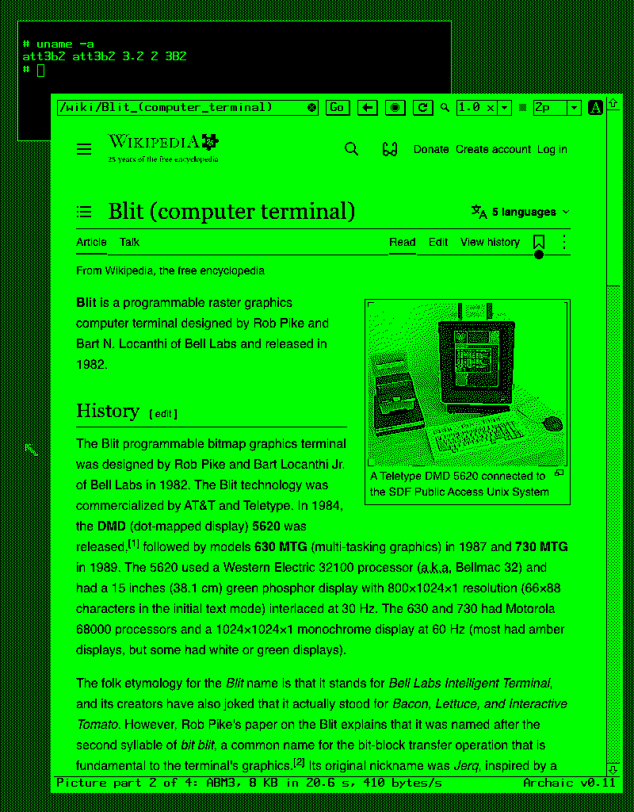


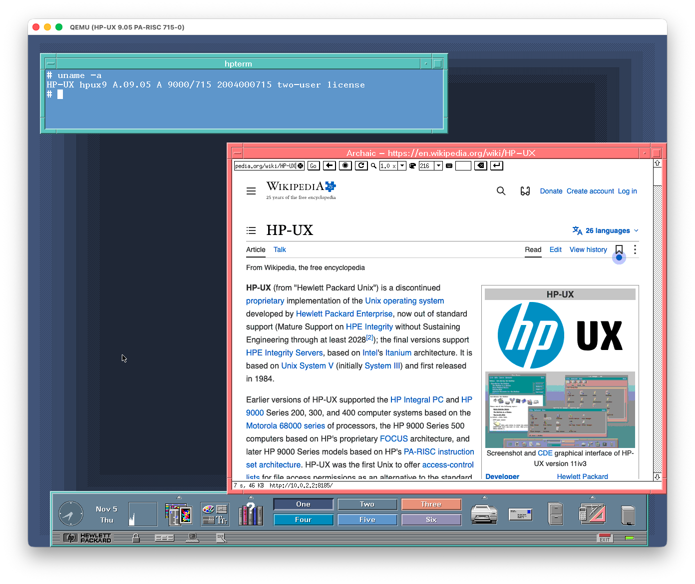

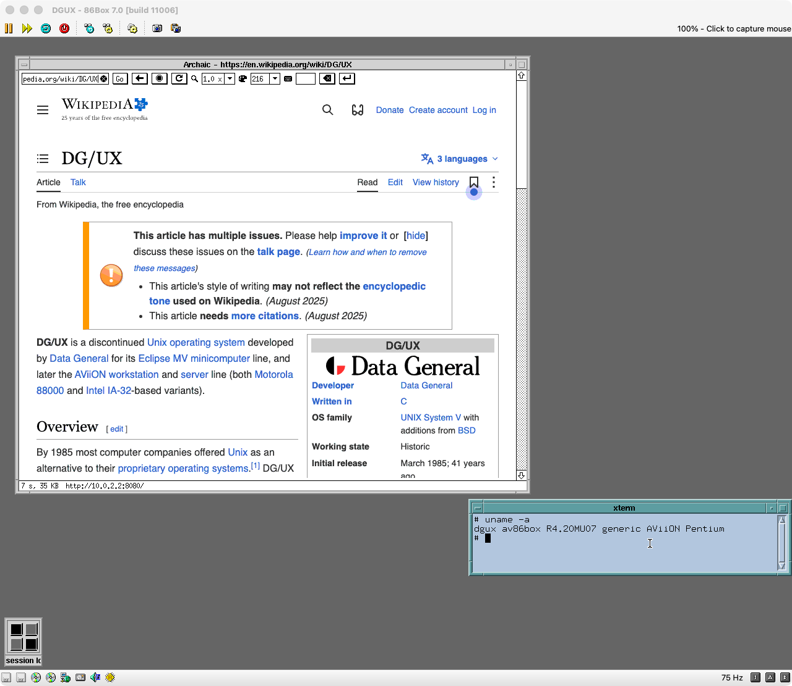


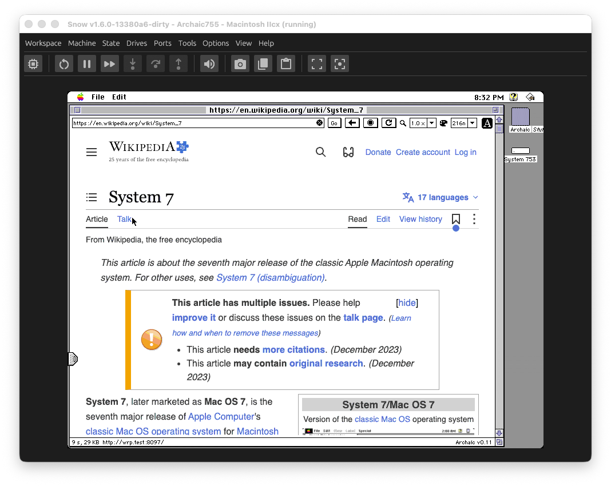

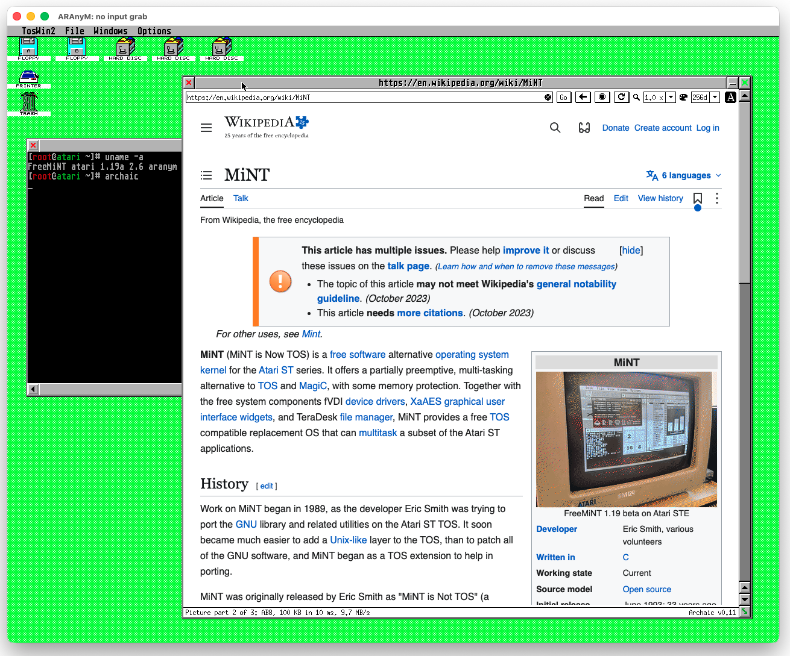

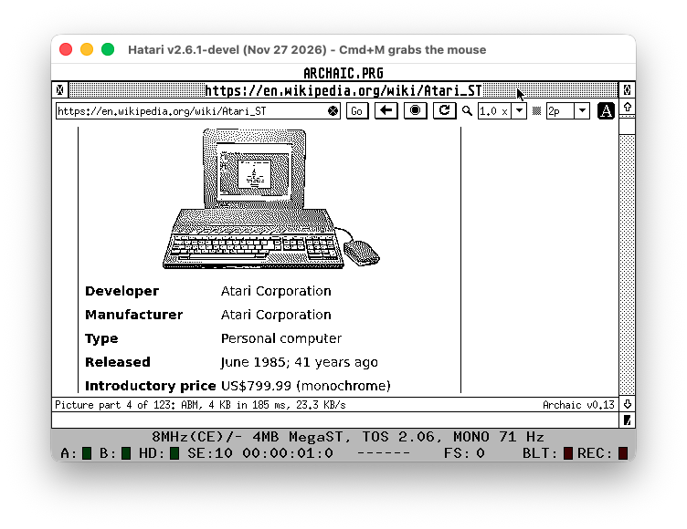

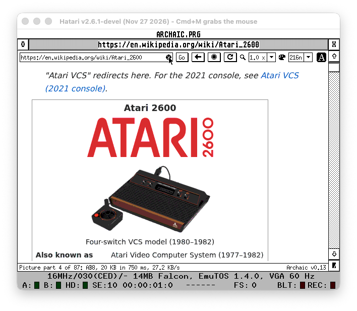

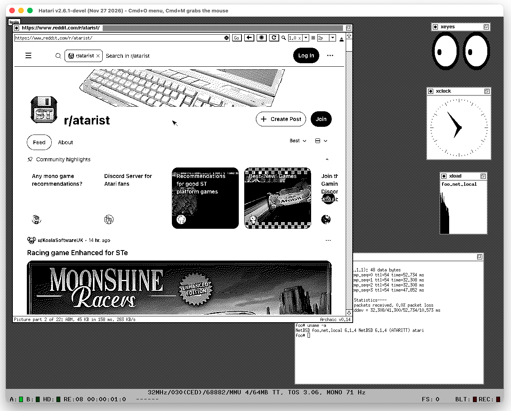

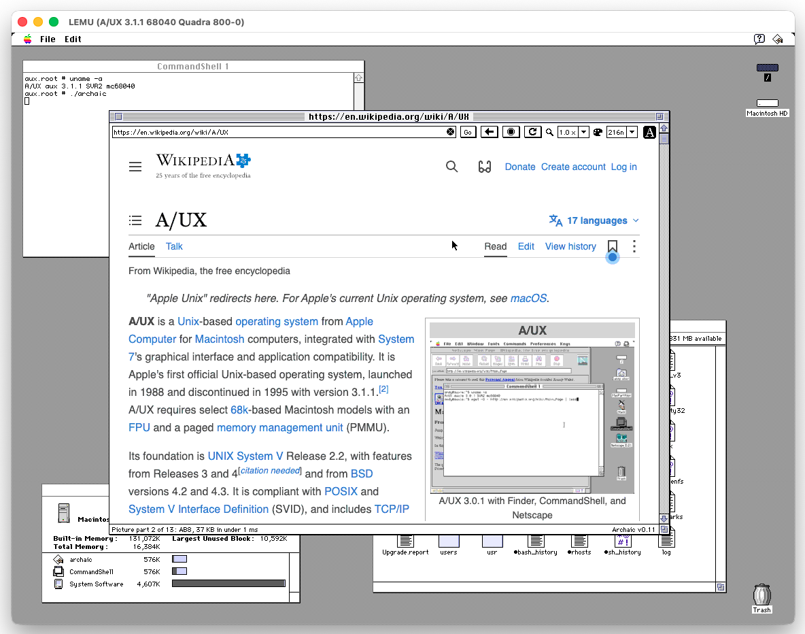

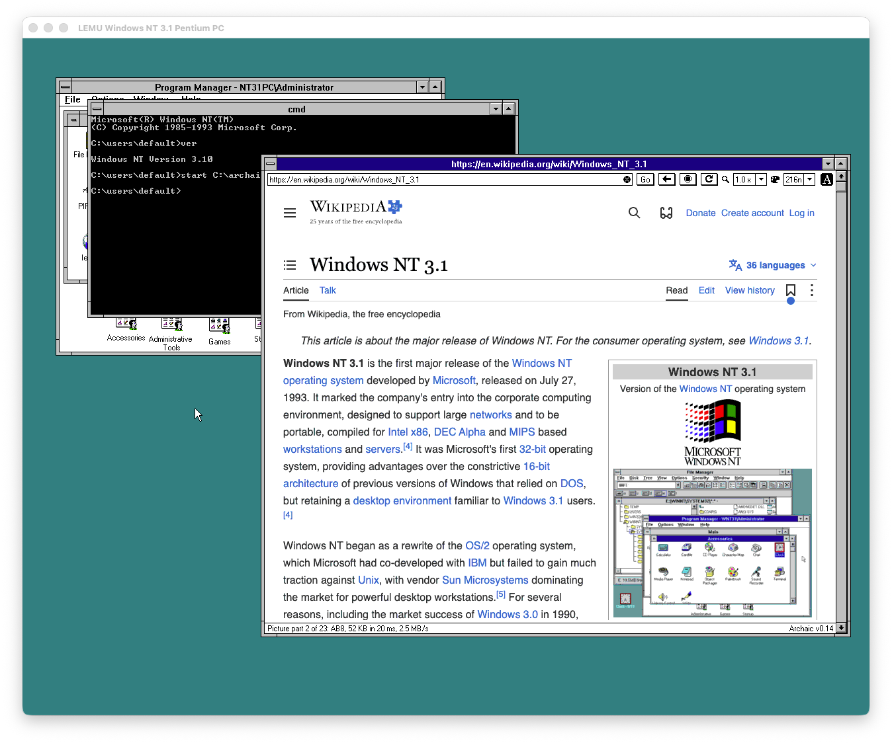

## Platforms

| System | Window system | Network | Get it |
|---|---|---|---|
| Whitesmiths Idris 3.14 on the Atari ST | X10 | TCP/IP over SLIP | release: `archaic-idris`, or in the Idris kit |
| AT&T UNIX PC (3B1, PC 7300) | its own | WIN/TCP on its Ethernet board | release: `archaic-3b1`, or in the 3B1 kit |
| UNIX System V Release 3.2 on an AT&T 3B2 | layers, on a DMD 5620 terminal (the Blit) | WIN/3B on its Ethernet board | release: `archaic-3b2`, or in the 3B2 kit |
| SunOS 4.1 on a Sun-4 (SPARC) | SunView, in color | BSD sockets | release: `archaic-sun4`, or in the SunOS 4 kit |
| SunOS 3.5 on a Sun-3 (68020) | SunView | BSD sockets | release: `archaic-sun3`, or in the Sun-3 kit |
| HP-UX 9 on an HP 9000/700 (PA-RISC) | X11, in color | BSD sockets | release: `archaic-hpux9`, or in the HP-UX kit |
| DG/UX R4.20 on a PC (Intel) | X11, in color | BSD sockets | release: `archaic-dgux`, or in the DG/UX kit |
| AIX 3.2 on an IBM RS/6000 | X11, in color | BSD sockets | release: `archaic-aix3`, or in the AIX kit |
| AIX PS/2 1.3 on a PC (486) | X11, in color | BSD sockets | release: `archaic-aixps2`, or in the AIX PS/2 kit |
| Ultrix 4.5 on a DECstation (MIPS) | X11 (DECwindows), in color | BSD sockets | release: `archaic-ultrix4`, or in the DECstation kit |
| Mac OS 6 (System 6) on a 68k Mac (Mac II) | QuickDraw, in color | MacTCP | release: `archaic-macos6.dsk` (a floppy image), or `make mac` |
| Mac OS 7.5 on a 68k Mac (Mac II) | QuickDraw, in color, multitasking | Open Transport | release: `archaic-macos7.dsk` (a floppy image), or `make mac` |
| FreeMiNT on an Atari (ARAnyM: TT/Falcon-class 68040) | GEM (XaAES), in color | MiNTNet (BSD sockets) | `make mint`: `archaic-mint.prg` |
| TOS on an Atari ST, STE, TT or Falcon | GEM, in color with 16 colors or more | STinG (NetUSBee, EtherNEC) | `make tos`: `archaic-tos.prg` |
| NetBSD 6 and newer on a 68k machine (Atari TT) | X11 | BSD sockets (NetUSBee, EtherNEC) | release: `archaic-netbsdm68k`, or `make` on NetBSD |
| A/UX 3.1 on a 68k Mac (Quadra) | the A/UX Toolbox (QuickDraw), in color, multitasking | BSD sockets | in the A/UX kit, or build it on A/UX: `sh mkaux` |
| Windows NT 3.1 and newer on x86, MIPS and Alpha, NT 3.51 and newer on PowerPC, NT 3.5 and 4.0 on ARM (PINT, the Raspberry Pi) | Win32 (GDI), in color | Winsock | `make nt`: `archaic-ntx86.exe`, `archaic-ntmips.exe`, `archaic-ntalpha.exe`, `archaic-ntppc.exe`, `archaic-ntarm.exe` |
| Unix | X11 | BSD sockets | `make` |
| macOS | Cocoa | BSD sockets | `make cocoa` |
| anything with SDL 2 | SDL 2 | BSD sockets | `make sdl` |
| no window (tests, automation) | screenshots to files | BSD sockets | `make headless` |

The binaries are in [releases](https://github.com/tenox7/archaic/releases).
The code is plain old C, written to port to DOS, OS/2, Win16 and others.

## Quick start

1. Run [WRP](https://github.com/tenox7/wrp) on another computer: `wrp`. It listens on port 8080.
2. On the old computer, point Archaic to it: `archaic HOST:8080`.

## Using it

WRP's form is one line at the top of the window:

| Part | Does |
|---|---|
| address box, Go | load a page.  clears the box |
|  | back |
|  | stop loading |
|  | reload |
|    | only with an older WRP: Backspace, Return and text for the web page |
|  | zoom |
|  | colors, with d (dither) or n (no dither): 256d, 216n ... (only on a display with colors) |
|  | dither, in black and white: 2p (only photos: sharp text, the default), 2d (all), 2n (none) |

To type into the web page, just type: the keys go to its box, and the status line shows the box's text.
Return sends it. To choose a box, click it in the picture.
After 3 s with no keys, a new picture shows what you typed (not on the 3B1, Idris and the DMD 5620).
With an older WRP: type in , then click .

| Key | Does |
|---|---|
| Return | Return for the web page (in the address box: load the page) |
| Tab | the web page's next box |
| Esc | stop loading |
| Page Up, Page Down, Space, b | scroll a window (Space and b: when no box has the keyboard) |
| ↑, ↓, mouse wheel | scroll a quarter of a window |
| right button (DMD 5620: the middle one) | scroll: top half of the window up, bottom half down |
| Ctrl-Q | quit |

The 3B1's own keys (Exit, Page, Prev) and the window frames of the 3B1, SunView, the Mac and GEM work too.

Where the window system has no scroll bar, Archaic draws its own, in the style of the Atari ST's GEM:

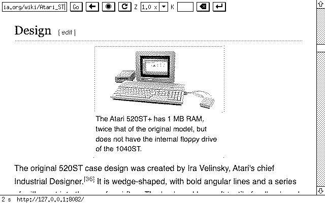

```
archaic [-g WxH+X+Y] [-a] [-c n] [-f type] [-t] [-v] [-o file] [-s script] [-r n] [-u] [-n] [--version] [--help] [url]
```

| Option | Does |
|---|---|
| `url` | WRP's address, like `10.0.2.2:8080` |
| `-g WxH+X+Y` | window size and place |
| `-a` | also show WRP's M, T and C menus |
| `-c n` | pictures in n colors (2 to 256) |
| `-f type` | ask WRP for one type of pictures: `gif`, `abm`, `abm3`, `ab8` or `small` |
| `-t` | test mode: no window |
| `-v` | status messages also to stderr |
| `-o file` | save the first picture (PBM or PPM) |
| `-s script` | play a script, then quit |
| `-r n` | a new picture n seconds after you stop typing into the page (default 3, 0 never) |
| `-u` | update Archaic now, then quit |
| `-n` | no updates |
| `--version` | show the version, then quit |
| `--help` | show all the options, then quit |

Archaic updates itself through WRP. Once a run it asks WRP for a newer Archaic.
Started as root, it installs it. Else it says that a newer one is out.

## Building

```
make              # ./archaic: X11 (on macOS: XQuartz)
make cocoa        # ./archaic-cocoa: a macOS window
make sdl          # ./archaic-sdl: SDL 2
make headless     # ./archaic-headless: no window
make mac          # src/build-mac/Archaic.dsk: Mac OS 6 and 7.5 on a 68k Mac (Retro68, in Docker)
make mint         # ./archaic-mint.prg: FreeMiNT with GEM on the Atari (m68k-atari-mint gcc, in Docker)
make tos          # ./archaic-tos.prg: TOS with GEM and STinG on the Atari (the same gcc, in Docker)
make test         # the tests (need ImageMagick)
```

On the old systems, copy the sources in, then:

| System | Build | Compiler |
|---|---|---|
| Idris | `sh mkinc`, then `sh mk` | Whitesmiths C 3.2 |
| 3B1 | `sh mkunixpc` | gcc 2.5.8 |
| 3B2 with a DMD 5620 | `sh mk3b2` | AT&T's cc (C Issue 4.2), and `dmdcc` for the terminal |
| SunOS 3 and 4 | `sh mksunview` | Sun's cc |
| HP-UX 9 | `sh mkhpux` | HP's cc |
| DG/UX R4.20 | `sh mkdgux` | DG/UX's cc (GCC 2.7.2) |
| AIX 3.2 | `sh mkaix` | IBM's XL C 1.3, or gcc 2.7.2 |
| AIX PS/2 1.3 | `sh mkaixps2` | MetaWare High C R2.2g |
| Ultrix 4 | `sh mkultrix` | Ultrix's cc, or gcc 3.0.4 |
| A/UX 3 | `sh mkaux` | A/UX's cc, with the A/UX Toolbox (libmac) |

With the whole repository, `make` runs the right script on AIX, HP-UX, DG/UX, Ultrix, SunOS and A/UX.
`CC=gcc make` uses gcc where the script takes it.

Which files to copy and how, the facts of each system, and how to port:
see [AGENTS.md](AGENTS.md).

## Roadmap

MGR, the Blit with mux on Research Unix, QNX Windows on QNX 2,
SunView on the Sun-2, SunWindows on SunOS 1, VWS and EWS on the VAX,
NeWS and Display PostScript, Windows 1 and 2, OS/2 1.x,
Tektronix 4010, 4014 and 4105 terminals. Plan 9 RIO.

## License

Apache License 2.0, like WRP. See `LICENSE`.
