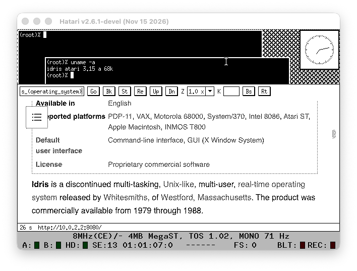
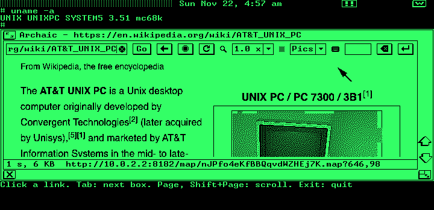

# Archaic

A very small web browser for very old computers.

Archaic is a client of **[WRP, the Web Rendering Proxy](https://github.com/tenox7/wrp)**.
WRP runs a modern browser on a modern computer. It sends each web page
as **one GIF picture** with a click map (ISMAP), plus a small HTML form.
Archaic shows the form and the picture, and sends your clicks and keys back.
WRP does all the hard parts: HTTPS, JavaScript, CSS, fonts.




First port: **Whitesmiths Idris** (a 1988 Unix clone) on the **Atari ST**,
with **X10** (X Version 10 Release 4) and TCP/IP over **SLIP**.
Second port: the **AT&T UNIX PC** (3B1, PC 7300, 1985), with its own
window system and **WIN/TCP** (The Wollongong Group's TCP/IP) on its Ethernet board.
Also, for development and tests: **macOS** (Cocoa), anything with **SDL 2**,
any Unix with **X11**, and **no window at all** (commands in, screenshots out).
The code is plain old C, written to port to DOS, OS/2, Win16 and others.

| What Archaic shows | What it skips |
|---|---|
| text fields, password fields | JavaScript, CSS, HTTPS (WRP does all that) |
| buttons, drop-down menus (SELECT) | check boxes, radio buttons, TEXTAREA |
| links, page title, line breaks | tables, fonts, colors |
| GIF pictures, clickable (ISMAP) | PNG, JPEG (Archaic asks WRP for GIF) |

---

## Quick start: Idris on the Atari ST

You need:

- **WRP** on your computer: [github.com/tenox7/wrp](https://github.com/tenox7/wrp).
- **Idris** on an Atari ST, or in the Hatari emulator: the Idris kit
  `atarist-idris314-hatari` (on osarchive, in `os/idris/virt/`).
  Newer kits have Archaic in `/usr/X/bin`.
- Or **this repo's [release](https://github.com/tenox7/archaic/releases)**:
  the `archaic` binary for Idris. Copy it into Idris's `/usr/X/bin`
  (kermit works), then `chmod /usr/X/bin/archaic`.
  With no mode, Idris's chmod makes a file executable.

Then:

1. On your computer, start WRP: `wrp`. It listens on port 8080.
2. In Idris, log in as `root` and start X: `/usr/X/bin/xstart`.
3. In an xterm, type `archaic`. It opens on the whole screen.
   (xstart puts `/usr/X/bin` on the search path. From a telnet login,
   type `/usr/X/bin/archaic`.)
4. Click the address box, type an address, press Return.
5. **Ctrl-Q** quits.

In the emulator kit, your computer is `10.0.2.2` for Idris.
So Archaic on Idris looks for WRP at `http://10.0.2.2:8080/`.
Somewhere else: `archaic HOST:PORT`, or `setenv WRP HOST:PORT`.

The ST's own screen, 640 x 400, black and white
(Archaic under the xterm, after three clicks on the ↓ button):


---

## Quick start: the AT&T UNIX PC (3B1)

You need:

- **WRP** on your computer, as above.
- A **3B1** with the Ethernet board and **WIN/TCP** (TWG's TCP/IP, in `/usr/ethernet`),
  or the **FreeBee** emulator: the kit `att3b1-unix351-freebee` (on osarchive, in `os/att/3b1/virt/`).
- The `archaic-unixpc` binary from this repo's **[release](https://github.com/tenox7/archaic/releases)**,
  or build it (see below). Copy it to the 3B1 as `/usr/local/bin/archaic`,
  then `chmod 755 /usr/local/bin/archaic`.

Then:

1. On your computer, start WRP: `wrp`. It listens on port 8080.
2. On the 3B1, open a shell window (Office > UNIX System) and type `archaic`.
   It opens a window of its own, as large as the screen allows.
   (A telnet or rsh login works too: the window opens on the 3B1's screen.)
3. Click the address box, type an address with `https://`, press Return.
4. **Exit** (or the close box in the window's frame) quits.

In the FreeBee kit, your computer is `10.0.2.2` for the 3B1, as for Idris.
So Archaic on the 3B1 looks for WRP at `http://10.0.2.2:8080/`.
The 3B1 has no DNS: give WRP's address as numbers, or put the name in `/etc/hosts`.

The 3B1's screen in FreeBee (green on black), 720 x 348.
Wikipedia's AT&T UNIX PC article, after one click on the ↓ button:



---

## Using it

```
archaic [=WxH+X+Y] [-a] [-t] [-v] [-o file.pbm] [-s script] [url]
```

| Option | Meaning |
|---|---|
| `url` | WRP's address, like `10.0.2.2:8080`. Default: `$WRP`, else port 8080 on the host (Idris and the 3B1: `10.0.2.2`, Unix: `127.0.0.1`) |
| `=WxH+X+Y` | window size and place (also `-g WxH+X+Y`). Default: the whole screen. On the 3B1: 686 x 248 inside a frame; a larger size gets no frame, up to 720 x 288 (`-g 720x288`) |
| `-a` | also show WRP's M, T and C menus (for future color ports; Idris does not need it) |
| `-t` | test mode: no window. Prints the page items and a checksum of each picture |
| `-v` | status messages also go to stderr |
| `-o file.pbm` | at the end, save the first picture as a PBM file |
| `-s script` | play a script, then quit (see Testing) |

**WRP's settings are set by Archaic, and not shown:**

| WRP box | Archaic sends |
|---|---|
| W, H | the window's size: the picture fills the window. Always, also with `-a` |
| M (mode) | ISMAP |
| T (picture type) | GIF |
| C (colors) | 2 |
| SL (slices) | 1: the whole page, in slices (see Scrolling). An older WRP ignores it |

So WRP's form is one line: the address box, **Go**, WRP's buttons, **Z** (zoom) and **K** (keys).

**WRP's buttons are pictures**, like in a modern browser.
(WRP names them with 2 letters, because old browsers can only put text on a button.)

| Picture | WRP's name | Does |
|---|---|---|
| ← arrow | Bk | back |
| stop sign | St | stop loading |
| ↻ circle arrow | Re | reload |
| ↑ and ↓ arrows | Up, Dn | scroll the web page one screen up or down. Only an older WRP shows them: see Scrolling |
| ⌫ | Bs | Backspace, for the web page |
| ↵ | Rt | Return (Enter), for the web page |

To type into a box on the web page: click the box in the picture, type in **K**,
press Return (WRP types it into the page), then click ↵ if the page needs Enter.

**Mouse**

- Left button: click links, buttons, fields, menus, and the picture.
- Right button: scroll a window. Top half of the window = up, bottom half = down.
- The scroll bar at the right: see Scrolling below.

**Keys**

| Key | Does |
|---|---|
| Tab | next text field |
| Return | send the form |
| Backspace / Delete | delete the last character |
| Ctrl-U | clear the field |
| Esc | stop loading (or leave the field) |
| Space / b | scroll a window down / up (when no field has the keyboard) |
| Ctrl-Q | quit |

**On the 3B1**, its own keys and the window's frame work too:

| Key or frame part | Does |
|---|---|
| Exit, Cancl, the close box | quit |
| Page, Next / Shift+Page, Prev | scroll a window down / up |
| ↓ / ↑, the scroll arrows (also FreeBee's mouse wheel) | scroll a quarter of the window down / up. The frame's scroll arrows are the window's own scroll bar: Archaic draws none on the 3B1 |
| Rfrsh, Clear | draw the window again |
| the resize box | a new window size. Then click ↻ for a picture that fits |

**On macOS (Cocoa) and with SDL:** Page Up and Page Down scroll a window.
The up and down arrows and each step of the mouse wheel scroll a quarter of it.
A trackpad scrolls smoothly, by pixels. Ctrl+click is the right button.
Cmd-Q and the window's close button quit.
Cocoa has the Mac's own scroll bar; SDL has Archaic's (see Scrolling).

The help line at the bottom of the screen lists the main keys.

**Scrolling: the whole page in slices**

With a WRP that knows slices (`sl=1`), WRP makes a picture of the whole page once, and keeps it.

- Archaic shows the picture in a frame under WRP's form. Only the frame scrolls: the form stays at the top.
- The picture comes in **slices** as high as the frame. Archaic keeps 4 of them:
  the ones on the screen, and the next one above and below.
  It gets the next ones while you read, so most scrolls do not wait for the network.
- A click on the picture goes to WRP as a place on the whole page.
- After a click or keys on the same page, the frame stays where it was. A new page starts at its top.
- WRP leaves out its Up and Dn buttons.
- A slice is a 2-color GIF: about 5 to 9 KB for 632 x 351 pixels.

| Input | Scrolls the frame |
|---|---|
| a step of the wheel, ↑ ↓, the 3B1's scroll arrows and Roll keys | a quarter of the frame |
| Page Up, Page Down, Space, b, the right button, the 3B1's Page, Next, Prev | the frame, less 2 text lines |
| a trackpad (Cocoa, SDL) | by pixels |

An older WRP ignores `sl=1`: then the picture fills the window, and WRP's Up and Dn buttons scroll the page.

**The scroll bar**

A system that has scroll bars uses its own. Where it has none, Archaic draws one.

| Display | Scroll bar |
|---|---|
| Cocoa (macOS) | the Mac's own (NSScroller), always shown. A click in its track scrolls as Page Down or Page Up, or jumps to that place, as set in System Settings (with Option, the other one) |
| the 3B1 | the window frame's scroll arrows |
| SDL, X11, X10 (the Atari ST), headless | Archaic's own, in the style of the Atari ST's GEM |

Archaic's own scroll bar is at the right of the window, 17 pixels wide:


| Part | Does |
|---|---|
| ⇧ and ⇩ arrow boxes | scroll a quarter of the frame. Hold the button down: again every 1/10 s, after 4/10 s |
| the dotted shaft, above or below the elevator | scroll as Page Up or Page Down. Held down, it goes on until the elevator gets to the pointer |
| the white elevator | drag it. Its length shows how much of the page is in the window, its place where |

On X10 the elevator moves when the button is let go (as in GEM), and held parts do not repeat:
X10 has no events for the mouse moving with a button down, and can't wait for a time.

---

## Files

| File | What it is |
|---|---|
| `src/archaic.h` | everything shared, and the C rules for old compilers |
| `src/main.c` | the page on the screen: layout, drawing, mouse, keys, forms |
| `src/html.c` | HTML reader: forms, menus, links, images, text |
| `src/http.c` | URLs and HTTP/1.0, with a 16 KB read buffer |
| `src/gif.c` | GIF decoder: to black and white, 4x4 dither |
| `src/x10.c` | display for X10 (Idris) |
| `src/nidris.c` | network for Idris: TCP through netd |
| `src/x11.c` | display for X11 (Unix, macOS with XQuartz) |
| `src/cocoa.m` | display for macOS: a Cocoa window |
| `src/sdl.c` | display for SDL 2 (macOS, Linux, Windows ...) |
| `src/headless.c` | display with no window, for tests and automation: commands on standard input, screenshots |
| `src/fb.c`, `fb.h` | a screen in memory, for `cocoa.m`, `sdl.c` and `headless.c`; writes PNG screenshots |
| `src/font6x13.h` | the X11 6x13 font (public domain), for `fb.c` |
| `src/nsock.c` | network for BSD sockets (Unix, macOS) |
| `src/fetch`, `mkinc`, `mk`, `lka` | Idris scripts: get the sources, headers, compile, link |
| `src/unixpc.c` | display for the AT&T UNIX PC (3B1) window system |
| `src/ntwg.c` | network for the 3B1: the BSD sockets of WIN/TCP (TWG) |
| `src/mkunixpc` | 3B1 script: compile and link with gcc |
| `tools/idris.py` | host tool: run commands in Idris over telnet, serve files |
| `tools/hget.c` | Idris tool: download one file over HTTP (through netd) |
| `tools/pcf2c.py` | host tool: an X11 PCF font as a C table (it made `font6x13.h`) |
| `test/run.sh` | tests: GIF decoder, HTML, forms, WRP, the headless display |
| `test/xshot.sh` | test: run the X11 build and take a screenshot |
| `test/data/` | GIFs saved from WRP, for the tests |
| `test/cfacts.c`, `cfacts2.c` | probe for a new port: what its C compiler and linker do (name length, case, struct copies) |
| `screenshots/` | the pictures in this README |

---

## Building and testing on Unix or macOS

```
make              # ./archaic, X11 + BSD sockets
make cocoa        # ./archaic-cocoa, a macOS window
make sdl          # ./archaic-sdl, SDL 2
make headless     # ./archaic-headless, no window: for tests and automation
make archaic-asan # X11 with address and undefined-behaviour checks
make knr          # syntax check as a pre-ANSI compiler sees it (-DNOPROTO)
make test         # sh test/run.sh
```

- `make` needs X11 (on macOS: XQuartz in `/opt/X11`).
- `make cocoa` needs only the Xcode command line tools.
- `make sdl` needs SDL 2: `sdl2-config` on the PATH (`brew install sdl2`).
- `make headless` needs only a C compiler.
- The tests need ImageMagick.

Cocoa, SDL and headless draw the same pixels, with the X11 6x13 font.
On a Retina screen, Cocoa and SDL show each pixel as 2x2.

### No window: archaic-headless

`archaic-headless` reads commands from standard input, one per line.
It reads the next command only when Archaic has nothing else to do,
so a command that loads a page ends before the next one starts.
At the end of the input, Archaic quits.

| Command | Does |
|---|---|
| `click X Y [B]` | press mouse button B (1 left, 2 middle, 3 right) at X, Y, and let it go |
| `down X Y [B]`, `up X Y [B]` | press the button and hold it down; let it go |
| `move X Y` | move the mouse, with the button down (to drag the scroll bar's elevator) |
| `key K` | a character, or `return`, `tab`, `esc`, `backspace`, `delete`, `space`, `pgup`, `pgdn`, `up`, `down`, `ctrl-X` |
| `type TEXT` | the rest of the line, as keys |
| `scroll up`, `scroll down` | a window, as Page Up and Page Down |
| `wheel N` | N steps of the mouse wheel (a quarter of the window each); down if N > 0, up if N < 0 |
| `pixels N` | N pixels, as a trackpad; down if N > 0, up if N < 0 |
| `size W H` | the window is now W x H |
| `shot FILE` | write the screen to FILE: PNG, or PBM if the name ends in `.pbm` |
| `sleep MS` | wait MS milliseconds. While a part of the scroll bar is held down, the time is counted in steps of 1/10 s and not waited, so a held arrow repeats the same way in every run |
| `quit` | quit |

Empty lines and lines that start with `#` do nothing. Standard output gets
`title TEXT` for each page, and `shot FILE WxH` for each screenshot.

```
printf '%s\n' 'click 20 12' 'type https://en.wikipedia.org/wiki/AT%26T_UNIX_PC' \
    'key return' 'shot page.png' 'scroll down' 'shot down.png' |
    ./archaic-headless -v -g 800x600 127.0.0.1:8080
```

`test/run.sh` checks:

1. GIF decoding gives **exactly** the same pixels as ImageMagick.
2. Gray and color GIFs decode at the right size.
3. HTML: title, entities, fields, menus, hidden fields, buttons, links, comments.
4. A button click sends the form with the right query.
5. WRP's form: W, H, M, T and C are hidden, and Archaic sends its own values (and with `-a`, the menus). WRP's 7 buttons are pictures, Go stays text.
6. With WRP running (default `127.0.0.1:8089`): the start page, then a page with a window-wide picture.
7. `archaic-headless`: PNG and PBM screenshots (the same pixels), typing into a form and sending it, a new size.
8. The tall picture, with no WRP: the test server cuts a random 600 x 1500 GIF into slices.
   After a wheel step, a window and a scroll to the end, the frame must show exactly the right rows.
   Also: the next slice comes before it is needed, and a click sends the place on the whole page.
9. Archaic's scroll bar, on the same picture: the arrows, a click in the shaft, the elevator
   dragged (back to where it was, and past the end), an arrow held down for 1 s.
   In 10 shots, the frame must show the right rows, and the elevator must be at the right place.
   Clicks on the bar must not go to the page.

Run WRP for the tests: `wrp -l 127.0.0.1:8089`.

To see the real window without a desktop, use Xvfb:

```
Xvfb :7 -screen 0 660x420x24 -listen tcp -nolisten local -nolisten unix &
PATH=/opt/X11/bin:$PATH sh test/xshot.sh 127.0.0.1:7 shot.png 1 '%%' 127.0.0.1:8089
```

---

## Building in Idris

### 1. Move the files in

A tiny HTTP client, **hget**, brings files from your computer through netd.
You type hget in only once.

Serve this folder from your computer (leave it running):

```
python3 tools/idris.py 0 serve . 8077
```

Once: type hget's source into Idris over telnet, then build it.
(2323 is the kit's telnet port.)

```
python3 tools/idris.py 2323 put /src/archaic tools/hget.c
# then in Idris:
cd /src/archaic
cp /src/net/netc.h .
c hget.c
sh /src/net/lk hget
cp hget /usr/bin/hget
```

Then, in Idris, in an empty folder:

```
hget 10.0.2.2 8077 /src/fetch fetch
sh fetch
```

All 10 files (65 KB) take about 70 seconds.

### 2. Build

```
sh mkinc     # once per folder: the X10 headers
sh mk        # compile and link: archaic, about 80 KB
```

With Hatari's fast-forward on, `sh mk` takes about 1.5 minutes.
To relink only: `sh lka`.

> **Fast-forward**: turn it on only while waiting (compiles, X start).
> Never type with it on: every key repeats.

### 3. Test

**Test mode, no X needed** (with `tools/idris.py ... serve` running):

```
./archaic -t http://10.0.2.2:8077/test/data/hn2.gif
```

The last line ends with `sum ae2b58f3`: the same as on Unix.
That checks HTTP, netd and the GIF decoder in one go.

**With X:** start X, then run `./archaic` in an xterm (or from a telnet login).

**Scripts** (`-s`) act as a user, then quit:

| In the script | Means |
|---|---|
| a letter | that key |
| `~` | Return |
| `@x,y;` | left click at x, y in the window |
| `%` | wait 2 seconds |

Example: load a page, then keep the window 40 s for a screenshot:

```
./archaic -s '@50,10;http://en.wikipedia.org/~%%%%%%%%%%%%%%%%%%%%'
```

**Event trace:** `setenv ARCHAICDBG 1` prints every X event to stderr.

**Measured on the emulated Mega ST:**

| What | Time |
|---|---|
| WRP start page | 4 s |
| Hacker News page with its 10.7 KB picture | 36 s from Return |
| Wikipedia page with its 9 KB picture | 30 s from Return |
| decode check (`-t`, two 11 KB downloads) | 25 s |

---

## Idris on the Atari ST: what to know

Test on a copy of your Idris disk.

### The system

| Thing | Idris |
|---|---|
| CPU, memory | 68000 at 8 MHz, 4 MB, no MMU |
| Screen | 640 x 400, black and white |
| Window system | **X10** (not X11): `Xlib.o`, `XText`, `XPixSet`, `XBitmapBitsPut` |
| Network | netd: SLIP on the serial port. AF_UNIX socket `/tmp/netd` |
| Addresses (emulator kit) | Idris 10.0.2.15. **Your computer = 10.0.2.2** (its 127.0.0.1) |
| Speed | about 1.6 KB/s to Idris, 0.7 KB/s back |
| File names | 14 characters at most |

### The C compiler (Whitesmiths C 3.2)

- `int` is 32 bits. Plain `char` is **unsigned**.
- Prototypes work, but `__STDC__` is not defined. `_WSLAS` is.
- **Bug**: `a[n - 1]` on a **local** array reads the wrong memory. Make arrays `static`.
- `putc()` on stderr crashes. `fprintf(stderr, ...)` is fine.
- `c file.c` compiles, then tries to link and prints `undefined: ...`. That is normal.
- `<X/Xlib.h>` is not on the include path, and `Xlib.h` wants a
  `<sys/param.h>` that Idris does not have. `sh mkinc` fixes both,
  in the build folder.
- The default link line allows only a small BSS. `lka` adds `-m0xffffffff` to `+bss`.
- `XCloseDisplay` pulls in `sigsetmask`, which no library has. Archaic does not call it.

### The shell

- No `for`, no `if`, no `2>&1`. Variables are one letter. Use `setenv NAME value`.
- **`$` is expanded even inside single quotes.** So `-s` scripts have no `$`.
- `#` is **not** a comment. `:` with plain words is.
  Even then, no quotes, `;` or brackets in it.
- `cp /dev/null file` copies the device. Use `cat /dev/null > file`.
- `rm` has no `-f`. There is no `tail`, no `which` and no `rmdir`:
  `rm -d DIR` removes an empty directory.
- `chmod 755 file` does not work: chmod takes flags, not numbers.
  `chmod file` (no mode) makes a file executable.
- `$PATH` is `$P` followed by `ATH`. The command search path is `$X`.

### X10 on this ST

- The screen size reads as 0 x 0. Archaic then uses 640 x 400.
- The keyboard goes to the window under the mouse pointer.
  Archaic moves the pointer into its window when it opens.
- Bitmaps: rows of 16-bit shorts, the **low** bit is the **left** pixel.
- The **left** mouse button comes as `MiddleButton` (1), the right one as `RightButton` (0).
- All four arrow keys come as the same key. Archaic does not use them.
- No scroll bars: Archaic draws its own. Archaic asks for no motion events:
  the elevator moves when the button is let go, as in GEM.
- **The root window's X cursor is drawn 7 pixels up and left of where it clicks.**
  Archaic sets its own arrow cursor, with the hot spot at its tip (0,0).
- Cursor colors are ignored: cursor bit 1 is drawn white, the rest of the mask black.
- Start X: log in on the console, run `/usr/X/bin/xstart`. It takes about 40 s.

### netd

- Send `tcp HOST PORT\n`. The answer line is `ok ...` or `err why`.
- Then the data. From netd, byte `0377` comes twice, and `0377 0` means the end.
- The program closes the socket, never netd.
- Sockets ignore FIONBIO: a read waits. Read only what `FIONREAD` says is there.
- `select()` takes one `unsigned long` as the mask, and whole seconds.
- netd treats a short write as "the program has gone". So read soon.
  Archaic keeps a 16 KB buffer and fills it while it decodes the picture.

---

## Building on the AT&T UNIX PC (3B1)

Needs **gcc** (2.5.8 in `/usr/local/bin`: the FreeBee kit has it) and WIN/TCP.

1. Copy these 8 files (74 KB) into a folder on the 3B1, with ftp, rcp or a floppy:
   `src/archaic.h`, `main.c`, `html.c`, `http.c`, `gif.c`, `unixpc.c`, `ntwg.c` and `mkunixpc`.
   The FreeBee kit forwards the 3B1's ftp to port 35121 on your computer, and rsh to 35514.
2. Build:

   ```
   sh mkunixpc     # compile and link: archaic, about 43 KB
   ```

   It takes about 40 s in FreeBee at turbo 10.
3. Test. **Test mode, no window needed** (serve this folder from your computer:
   `python3 -m http.server 8077`):

   ```
   ./archaic -t http://10.0.2.2:8077/test/data/hn2.gif
   ```

   The last line ends with `sum ae2b58f3`: the same as on Unix and on Idris.

   **With the window:** `./archaic` in a shell window.

**Measured in FreeBee** (from Return until the picture is complete):

| What | 10 MHz, as a real 3B1 | turbo 10, as in the kit |
|---|---|---|
| WRP start page (`-t`) | 1 s | 0.1 s |
| decode check (`-t`, an 11 KB GIF) | 10 s | 1 s |
| Wikipedia page with its picture | 12 s | 2 s |
| ↓ on it (a dithered photo) | 18 s | 7 s |

---

## The AT&T UNIX PC (3B1): what to know

Test on a copy of your 3B1 disk.

### The system

| Thing | 3B1 |
|---|---|
| CPU, memory | 68010 at 10 MHz, up to 4 MB, paged MMU |
| Screen | 720 x 348, black and white (FreeBee can show it green) |
| Window system | in the kernel: `/dev/window`, and **tam**, the window library (in the shared library) |
| Network | Ethernet board, **WIN/TCP** of The Wollongong Group: BSD sockets in `/usr/lib/libnet.a` |
| Addresses (FreeBee kit) | the 3B1 10.0.2.15. **Your computer = 10.0.2.2** (its 127.0.0.1) |
| File names | 14 characters at most |

### The C compiler

- gcc 2.5.8 (`/usr/local/bin/gcc`, not on a stock 3B1). It defines `unixpc`:
  Archaic uses that for the default address.
- `-shlib` links the shared library: libc and tam.
- `<time.h>` has no `time_t`: it is in `<sys/types.h>`.
- `/bin/cc`, the 1985 compiler, stops at the `#sccs` line of each header on the kit's disk. Archaic does not use it.
- SysV cannot replace a program that runs: quit Archaic before you link it again.

### The window system

- A window of its own: close 0, 1 and 2, open `/dev/window`, then `winit()` and `wcreate()`.
  `WIOCSETD` then sets the size in pixels.
- Windows live between y 12 and y 300. The frame adds 6 pixels at the left,
  28 at the right (with the scroll arrows), and 20 at the top and at the bottom.
  So the largest inside is 686 x 248, or 720 x 288 without a frame.
- `wrastop()` draws. **1 is a lit pixel**, and the **low** bit of each 16-bit word is the **left** pixel.
  Archaic makes white lit, so pictures are not negatives.
- Text: the font file `/usr/lib/wfont/system.8.ft` (9 x 12, ASCII only), drawn with `wrastop()`.
- `keypad(wn, 1)`: the 3B1's keys come as one code each (`kcodes.h`): Exit 0350, Cancl 0370, Page 0371.
  The window is a tty: with VMIN 0 and VTIME 1, a read waits at most 0.1 s.
- Mouse: `wsetmouse()` with MSDOWN. A click comes as the Mouse key (0375),
  then `wreadmouse()` gives x, y in the window and the buttons: 4 left, 2 middle, 1 right.
- The frame's scroll arrows send Roll Up and Roll Down (Shift+↑, Shift+↓). FreeBee's wheel does too.
- **SIGWIND** (the window has a new size) goes only to the window's process group.
  Archaic calls `setpgrp()` before it opens the window, then `ioctl(wn, WIOCPGRP, 0)`.
- `wprompt()` text shows on the screen's prompt line: 72 characters fit.

### WIN/TCP

- Headers in `/usr/ethernet/include`, the library `/usr/lib/libnet.a`.
  Compile with `-DSYSTEM5 -DSHORT_IDENT` (TWG's READ_ME).
- `select()` takes bit masks (a `long`), not `fd_set`, and waits as long as asked: 0.1 s works.
  Archaic waits on the network in 0.1 s steps and reads the window's keys between them.
- No DNS: `gethostbyname()` reads only `/etc/hosts`. Archaic tries `inet_addr()` first.

---

## Porting to DOS, OS/2, Win16 and others

The core (`main.c`, `html.c`, `http.c`, `gif.c`) does not change.
A port is **one display file** and **one network file**.

**Display (`g_` functions)**

| Function | Does |
|---|---|
| `g_open(geom, &w, &h)` | open a window, give its size |
| `g_close()`, `g_title(s)`, `g_flush()` | |
| `g_fill(x, y, w, h, c)` | rectangle, c: 0 white, 1 black |
| `g_invert(x, y, w, h)` | swap black and white |
| `g_text(x, y, s, n, inv)` | n characters, x, y = top left |
| `g_textw(s, n)`, `g_font(&height, &base)` | font size |
| `g_bits(x, y, w, h, bits, bpl)` | 1-bit rows, 1 = black, high bit left |
| `g_event(&e, wait)` | next key, click (`E_DOWN`, `E_UP`, and `E_MOVE` with a button down), expose, resize, quit, scroll (`E_SCROLL`: pixels, quarter windows, windows, or to a place). wait 0: don't wait; 1: wait for an event; 2: wait at most 1/10 s (or as 1) |
| `g_fd()` | the display's file descriptor, or -1 |
| `g_bar` | a variable: 0 if the system has scroll bars (Archaic then calls `g_sbar`), 1 if Archaic must draw its own |
| `g_sbar(pos, max, vis)` | show the page's place in the system's scroll bar: pos, 0 up to max; vis pixels show. Empty where `g_bar` is 1. The scroll bar sends `E_SCROLL` (`S_TO` for its knob) |

**Network (`n_` functions)**

| Function | Does |
|---|---|
| `n_open(host, port, err)` | connect; on error, the reason in `err` |
| `n_read(h, buf, n, wait)` | bytes read; -2 nothing yet, 0 end, -1 error. wait 1: up to 1 s |
| `n_write(h, buf, n)`, `n_close(h)` | |

**C rules** (they are in `archaic.h` too):

- K&R function definitions. Prototypes only through `P()`. `-DNOPROTO` turns them off.
- No `const`, `enum`, `void *`, struct assignment, structs by value.
- Parameters only `int`, `long` or pointers.
- No arrays in local variables (Whitesmiths bug). Make them static.
- `unsigned char` for bytes. `long` for byte counts and pixel offsets (int may be 16 bits).
- Few library calls: malloc, free, sprintf, printf, fprintf, getenv, time.

**Memory note for 16-bit systems:** the static data is about 130 KB
(page 30 KB, items 50 KB, read buffer 16 KB, GIF tables 18 KB).
On DOS or Win16, use the large memory model, or make these smaller in `archaic.h`.

---

## Known limits

- One page at a time. No history of its own: use WRP's back button (← arrow).
- A page over 30 KB of HTML is cut (WRP's pages are about 3 KB).
- On the 3B1, the font has only ASCII: other letters in WRP's form show as `?`.
- WRP before commit 3126bc0 (November 2026) could hang for good on back (← arrow),
  when Chrome took the page from its back-forward cache. Use a newer WRP.
- With slices, a link to a place on the same page (`#name`) does not scroll the frame there.

---

## License

Apache License 2.0, like WRP. See `LICENSE`.
