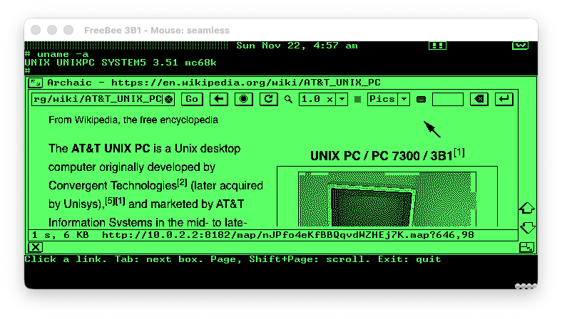
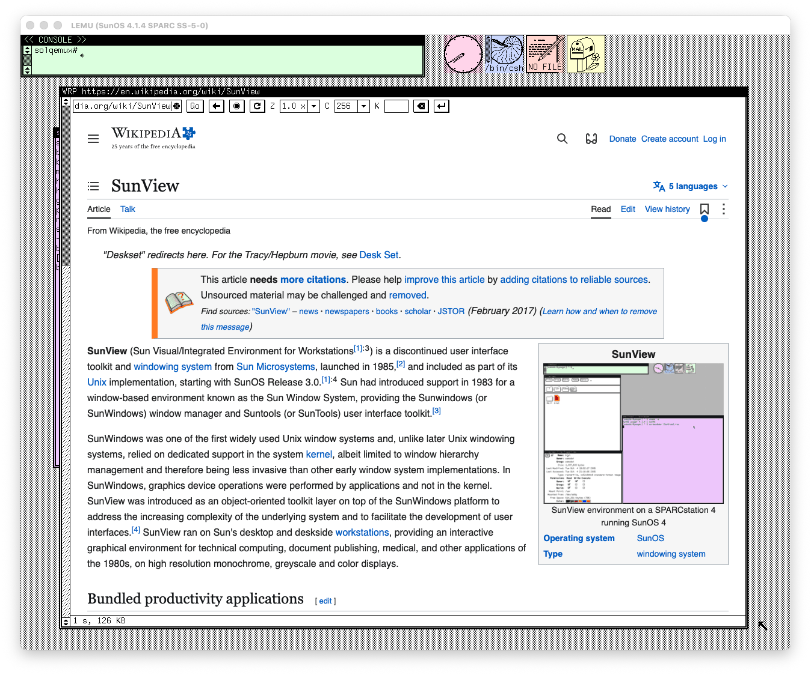
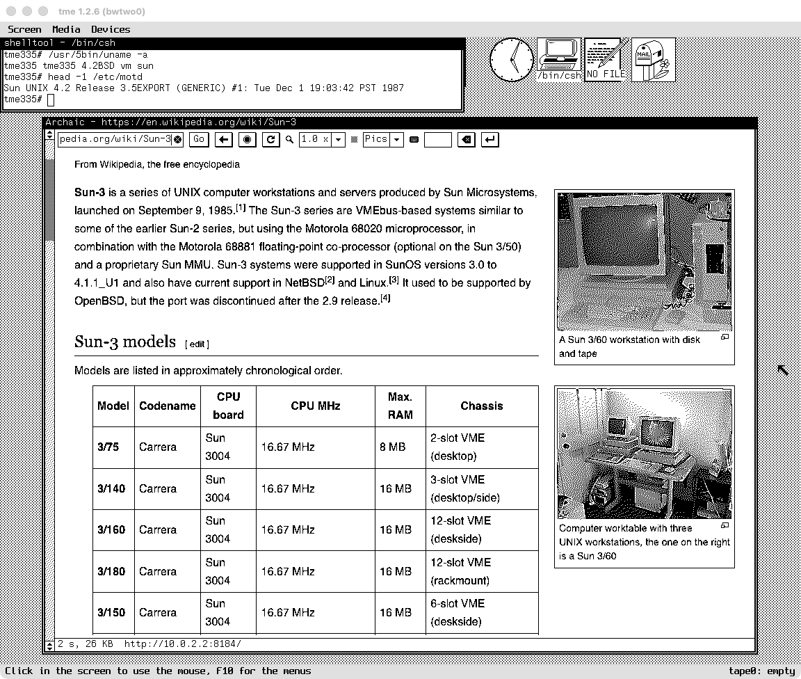
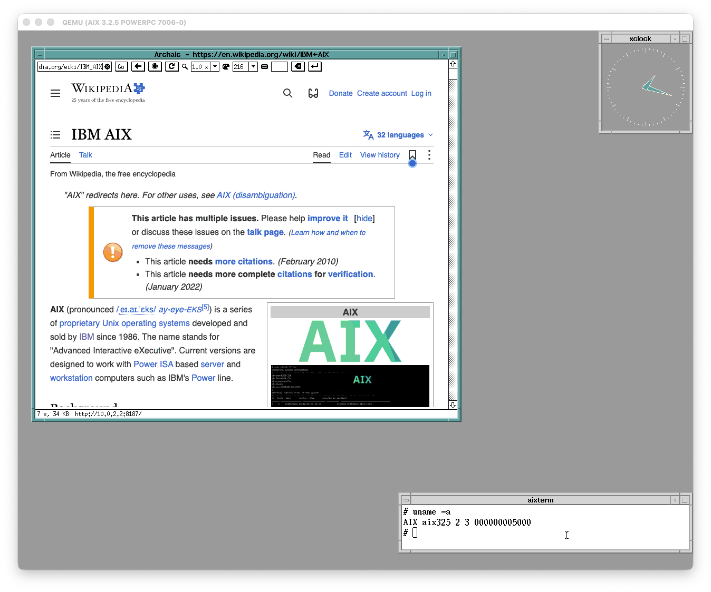
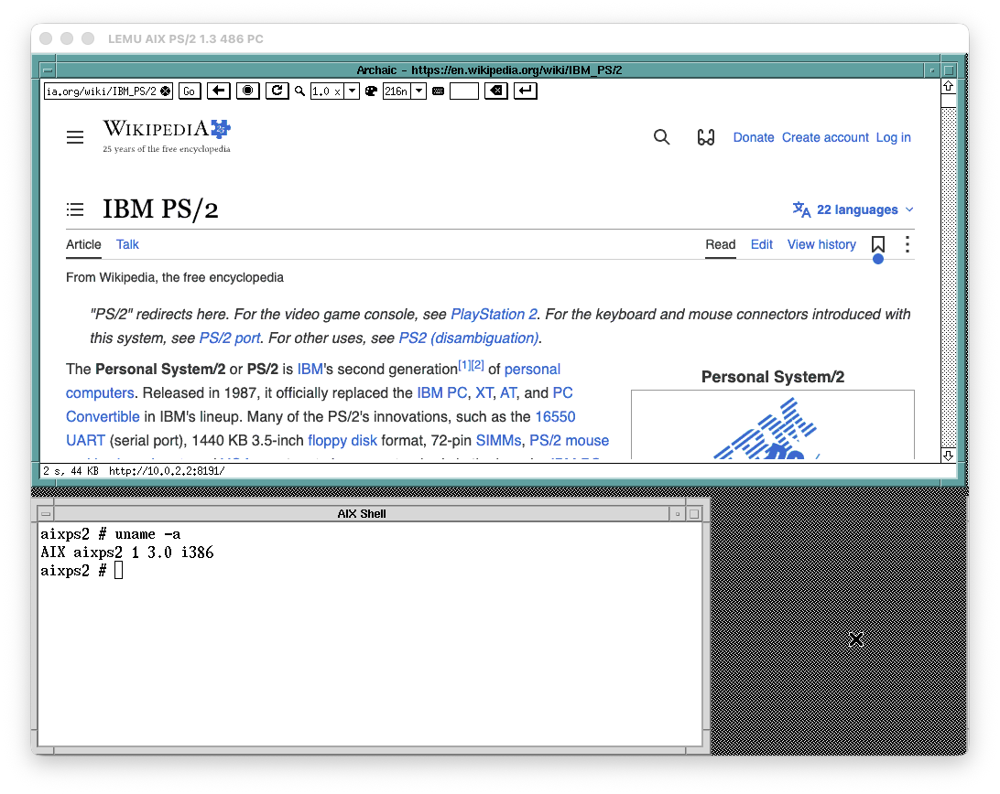
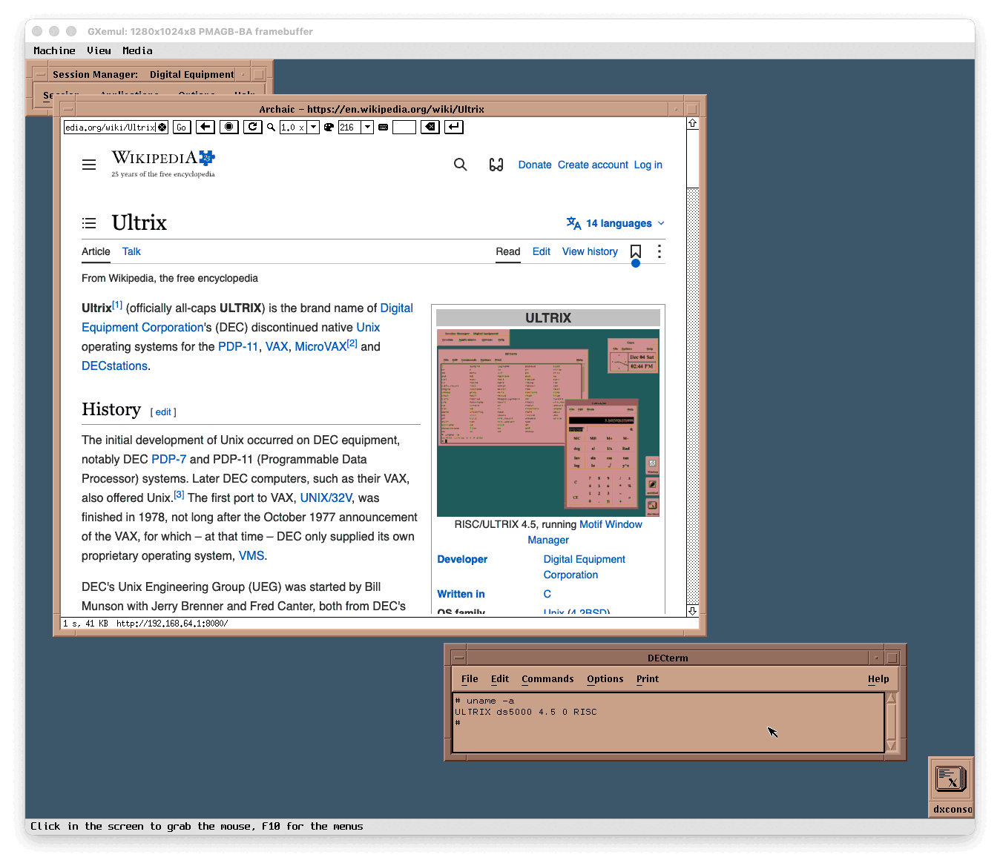
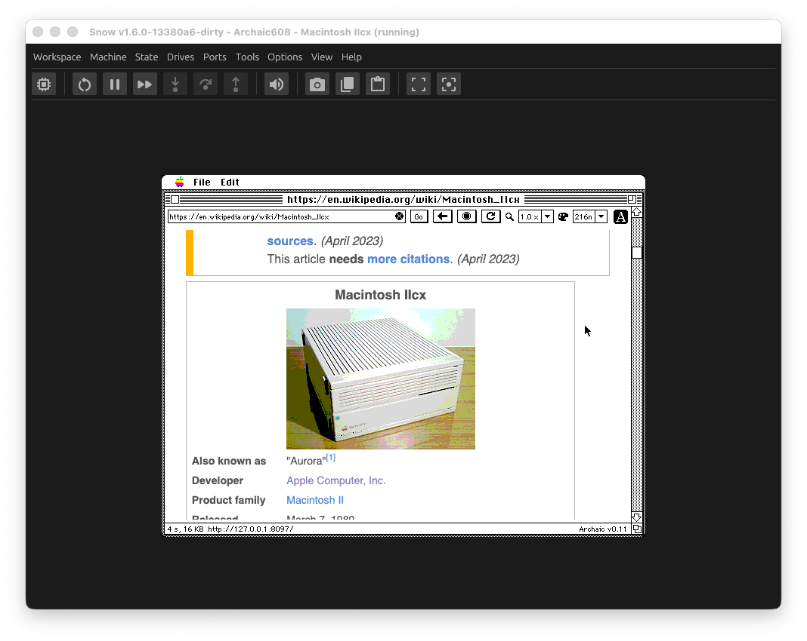

# Archaic

Small and ultra fast web browser for very old computers. 

Archaic is a dedicated client of **[WRP, the Web Rendering Proxy](https://github.com/tenox7/wrp)**.
WRP runs a modern browser on a modern computer. It sends each web page as a picture
with a click map, plus a small form. Archaic shows them, and sends your clicks and keys back.
WRP does all the hard parts: HTTPS, JavaScript, CSS, fonts.

## Performance

Archaic provides ultra fast and smooth browsing experience on vintage computers.
Unlike Netscape or Mosaic, Archaic is tightly integrated with WRP and provides the window size, scroll bar position and display properties.
This allows to pre-load and optimize, cache, send only small chunks of the page as you scroll.

## Screenshots

















## Platforms

| System | Window system | Network | Get it |
|---|---|---|---|
| Whitesmiths Idris 3.14 on the Atari ST | X10 | TCP/IP over SLIP | release: `archaic-idris`, or in the Idris kit |
| AT&T UNIX PC (3B1, PC 7300) | its own | WIN/TCP on its Ethernet board | release: `archaic-unixpc`, or in the 3B1 kit |
| SunOS 4.1 on a Sun-4 (SPARC) | SunView, in color | BSD sockets | release: `archaic-sun4`, or in the SunOS 4 kit |
| SunOS 3.5 on a Sun-3 (68020) | SunView | BSD sockets | release: `archaic-sun3`, or in the Sun-3 kit |
| HP-UX 9 on an HP 9000/700 (PA-RISC) | X11, in color | BSD sockets | release: `archaic-hpux9`, or in the HP-UX kit |
| DG/UX R4.20 on a PC (Intel) | X11, in color | BSD sockets | release: `archaic-dgux`, or in the DG/UX kit |
| AIX 3.2 on an IBM RS/6000 | X11, in color | BSD sockets | release: `archaic-aix3`, or in the AIX kit |
| AIX PS/2 1.3 on a PC (486) | X11, in color | BSD sockets | release: `archaic-aixps2`, or in the AIX PS/2 kit |
| Ultrix 4.5 on a DECstation (MIPS) | X11 (DECwindows), in color | BSD sockets | release: `archaic-ultrix4`, or in the DECstation kit |
| System 6 on a 68k Mac (Mac II) | QuickDraw, in color | MacTCP | `make mac`: a floppy image |
| Unix | X11 | BSD sockets | `make` |
| macOS | Cocoa | BSD sockets | `make cocoa` |
| anything with SDL 2 | SDL 2 | BSD sockets | `make sdl` |
| no window (tests, automation) | screenshots to files | BSD sockets | `make headless` |

The binaries are in [releases](https://github.com/tenox7/archaic/releases).
The code is plain old C, written to port to DOS, OS/2, Win16 and others.

## Quick start

1. On your computer, start [WRP](https://github.com/tenox7/wrp): `wrp`. It listens on port 8080.
   Use WRP 4.14.1 or newer. An older WRP works, with fewer features.
2. Copy the binary to the old computer as `archaic`, and make it executable:
   - Idris: `/usr/X/bin/archaic`, then `chmod /usr/X/bin/archaic` (with no mode).
   - 3B1, SunOS, HP-UX, DG/UX, AIX and Ultrix: `/usr/local/bin/archaic`, then `chmod 755 /usr/local/bin/archaic`.
   - The kits named in the table have it already. As root, it updates itself.
   - With curl or wget: `curl -O http://HOST:8080/archaic-download/archaic-hpux9`. WRP gets it from the newest release.
   - Mac: `make mac` makes a floppy image with Archaic: `src/build-mac/Archaic.dsk`.
3. Start the window system, then type `archaic` in a shell window:
   - Idris: log in as `root`, then `/usr/X/bin/xstart`.
   - 3B1: Office > UNIX System.
   - SunOS: log in as `root` at the console, then `sunview` (SunOS 3: `suntools`).
   - HP-UX: log in at the VUE login, then open a terminal.
   - DG/UX: log in as `root` at the X login. An xterm opens.
   - AIX: log in as `root` at the xdm login. An aixterm opens.
   - Ultrix: log in as `root` at the DECwindows login, then Applications > DECterm.
     Type `archaic HOST:8080`, with your computer's LAN address: gxemul's network can't reach its 127.0.0.1.
   - Mac: open Archaic in the Finder. Options go in a file `Archaic Options`, next to it.
4. Click the address box, type an address, press Return.
5. **Ctrl-Q** quits. On the 3B1: **Exit**. On the Mac: **Cmd-Q**.

## Using it

WRP's form is one line at the top of the window:

| Part | Does |
|---|---|
| address box, Go | load a page.  clears the box |
|  | back |
|  | stop loading |
|  | reload |
|    | only with an older WRP: Backspace, Return and text for the web page |
|  | zoom |
|  | colors, with d (dither) or n (no dither): 256d, 216n ... (only on a display with colors) |
|  | dither, in black and white: 2p (only photos: sharp text, the default), 2d (all), 2n (none) |

To type into the web page, just type: the keys go to its box, and the status line shows the box's text.
Return sends it. To choose a box, click it in the picture.
After 3 s with no keys, a new picture shows what you typed (not on the 3B1 and Idris).
With an older WRP: type in , then click .

| Key | Does |
|---|---|
| Return | Return for the web page (in the address box: load the page) |
| Tab | the web page's next box |
| Esc | stop loading |
| Page Up, Page Down, Space, b | scroll a window (Space and b: when no box has the keyboard) |
| ↑, ↓, mouse wheel | scroll a quarter of a window |
| right button | scroll: top half of the window up, bottom half down |
| Ctrl-Q | quit |

The 3B1's own keys (Exit, Page, Prev) and the window frames of the 3B1, SunView and the Mac work too.

Where the window system has no scroll bar, Archaic draws its own, in the style of the Atari ST's GEM:


```
archaic [-g WxH+X+Y] [-a] [-c n] [-f gif] [-t] [-v] [-o file] [-s script] [-r n] [-u] [-n] [--version] [--help] [url]
```

| Option | Does |
|---|---|
| `url` | WRP's address, like `10.0.2.2:8080` |
| `-g WxH+X+Y` | window size and place |
| `-a` | also show WRP's M, T and C menus |
| `-c n` | pictures in n colors (2 to 256) |
| `-f gif` | ask WRP for GIF pictures only |
| `-t` | test mode: no window |
| `-v` | status messages also to stderr |
| `-o file` | save the first picture (PBM or PPM) |
| `-s script` | play a script, then quit |
| `-r n` | a new picture n seconds after you stop typing into the page (default 3, 0 never) |
| `-u` | update Archaic now, then quit |
| `-n` | no updates |
| `--version` | show the version, then quit |
| `--help` | show all the options, then quit |

Archaic updates itself through WRP. Once a run it asks WRP for a newer Archaic.
Started as root, it installs it. Else it says that a newer one is out.

## Building

```
make              # ./archaic: X11 (on macOS: XQuartz)
make cocoa        # ./archaic-cocoa: a macOS window
make sdl          # ./archaic-sdl: SDL 2
make headless     # ./archaic-headless: no window
make mac          # src/build-mac/Archaic.dsk: the 68k Mac (Retro68, in Docker)
make test         # the tests (need ImageMagick)
```

On the old systems, copy the sources in, then:

| System | Build | Compiler |
|---|---|---|
| Idris | `sh mkinc`, then `sh mk` | Whitesmiths C 3.2 |
| 3B1 | `sh mkunixpc` | gcc 2.5.8 |
| SunOS 3 and 4 | `sh mksunview` | Sun's cc |
| HP-UX 9 | `sh mkhpux` | HP's cc |
| DG/UX R4.20 | `sh mkdgux` | DG/UX's cc (GCC 2.7.2) |
| AIX 3.2 | `sh mkaix` | IBM's XL C 1.3, or gcc 2.7.2 |
| AIX PS/2 1.3 | `sh mkaixps2` | MetaWare High C R2.2g |
| Ultrix 4 | `sh mkultrix` | Ultrix's cc, or gcc 3.0.4 |

With the whole repository, `make` runs the right script on AIX, HP-UX, DG/UX, Ultrix and SunOS.
`CC=gcc make` uses gcc where the script takes it.

Which files to copy and how, the facts of each system, and how to port:
see [AGENTS.md](AGENTS.md).

## Roadmap

MGR, the Blit and DMD 5620, QNX Windows on QNX 2,
SunView on the Sun-2, SunWindows on SunOS 1, VWS and EWS on the VAX,
NeWS and Display PostScript, Windows 1 and 2, OS/2 1.x,
Tektronix 4010, 4014 and 4105 terminals. Plan 9 RIO.

## License

Apache License 2.0, like WRP. See `LICENSE`.
